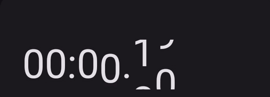
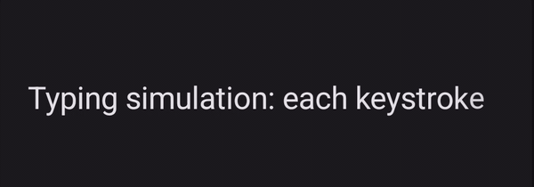

# Torph for Jetpack Compose

An unofficial port of [torph](https://github.com/lochie/torph) to Jetpack Compose: text that morphs between values. Characters shared between the old and new string glide to their new position, new ones fade in, removed ones fade out, and digits roll vertically by place value.

> **Personal project:** Not affiliated with or endorsed by Google or the upstream [torph](https://github.com/lochie/torph) project. See [License and attribution](#license-and-attribution).

```kotlin
TextMorph(text = "$1,234.50")          // change the string, get a morph
TextMorph(value = 1234.5, decimals = 2) // or hand it a number
```

| Numbers roll by place value | Shared letters glide into place |
| :---: | :---: |
|  |  |
| **Updates faster than the roll keep rolling** | **Rapid updates never snap** |
|  |  |

Recorded from the `:demo` app on a Pixel 10 Pro.

## Use it in your project

There is no Maven Central release yet; publish to `~/.m2/repository` or include the checkout as a composite build.

### Option 1: `mavenLocal()`

```bash
git clone https://github.com/c5inco/torph-compose.git
cd torph-compose
./gradlew publishLocal    # installs :torph-core and :torph-compose into ~/.m2/repository
```

```kotlin
// settings.gradle.kts
dependencyResolutionManagement {
    repositories {
        mavenLocal()
        google()
        mavenCentral()
    }
}

// app/build.gradle.kts
implementation("des.c5inco.torph:torph-compose:0.2.0") // brings :torph-core
```

Run `./gradlew torphCoordinates` to print the current coordinates, or pass `-PVERSION_NAME=0.3.0-SNAPSHOT` to `publishLocal`.

### Option 2: Composite build

```kotlin
// settings.gradle.kts
includeBuild("libs/torph-compose")

// app/build.gradle.kts
implementation("des.c5inco.torph:torph-compose")
```

Note:
- Your build must match the Android Gradle Plugin version in `gradle/libs.versions.toml`.
- Point the checkout at your Android SDK via `ANDROID_HOME` or `local.properties`.

### Requirements

- Android (`minSdk` 24+, `compileSdk` 37+, AGP 9.1+) or Compose for Desktop (JVM 17+).
- Built against Compose 1.12 (Compose BOM `2026.09.00` on Android, Compose Multiplatform `1.12.2` on Desktop); depends only on `foundation`, `animation`, `ui`, and `ui-text` (not Material).
- `:torph-core` (`des.c5inco.torph:torph-core`) is pure Kotlin/JVM if you only want segmentation and diffing.

## Modules

| Module | What | Depends on |
| --- | --- | --- |
| `:torph-core` | Pure Kotlin/JVM: segmentation, place-value number matching, diff, spring math. Unit-tested. | nothing |
| `:torph-compose` | Kotlin Multiplatform library (Android + Desktop JVM): `TextMorph`, `rememberTextMorphState`, `Modifier.textMorph`, easing helpers. | core, Compose foundation/animation/ui-text |
| `:demo` | Material 3 app mirroring torph.lochie.me: Playground, Numbers, Typing, Multi-line, Scripts, Interruption, Debug, Perf. | compose, Material 3 |

## API

```kotlin
@Composable
fun TextMorph(
    text: String,
    modifier: Modifier = Modifier,
    style: TextStyle = TextStyle.Default,
    color: Color = Color.Unspecified,
    ease: MorphEase = MorphEase.Curve(MorphEasings.Default),   // cubic-bezier(0.19, 1, 0.22, 1)
    duration: Duration = 400.milliseconds,                     // ignored for MorphEase.Spring
    scale: Boolean = true,            // scale entering/exiting segments 0.5 <-> 1
    numbers: Boolean = true,          // place-value matching + vertical roll
    locale: Locale = Locale.current,  // grapheme/word boundaries and number symbols
    cursorIndex: Int? = null,         // caret matching for editable fields
    segmentation: Segmentation = Segmentation.AUTO,  // GRAPHEME | WORD | AUTO
    sizeMode: MorphSizeMode = MorphSizeMode.Animate, // or Snap for fixed slots
    clip: MorphClip = MorphClip.Default,              // how far past the line box digits roll
    disabled: Boolean = false,
    respectReducedMotion: Boolean = true,
    debug: Boolean = false,           // draw segment rects, ids, enter/exit colours
    onAnimationStart: (() -> Unit)? = null,
    onAnimationComplete: (() -> Unit)? = null,
    onAnimationCancel: (() -> Unit)? = null,
    state: TextMorphState = rememberTextMorphState(),
)

sealed interface MorphEase {
    data class Curve(val easing: Easing) : MorphEase
    data class Spring(stiffness = 100f, damping = 10f, mass = 1f) : MorphEase
}

cssCubicBezier("cubic-bezier(0.19, 1, 0.22, 1)") // any CSS cubic-bezier or keyword easing, as written
```

Lower level: `rememberTextMorphState()` + `Modifier.textMorph(state)` for custom containers, and `segmentText` / `diffSegments` / `findNumericWords` from `des.c5inco.torph.core`.

### Clipping rolling digits

Rolling digits are drawn through a vertical clip band around the line box with faded top and bottom edges, measured in fractions of the line height:

```kotlin
TextMorph(value = count, clip = MorphClip.Default)    // 25% past the line box, 10% fade inset
TextMorph(value = count, clip = MorphClip.lineBox())  // clipped at the line box
TextMorph(value = count, clip = MorphClip.window())   // 6% inside the line box
TextMorph(value = count, clip = MorphClip(overflow = -0.1f, inset = 0.2f))
```

`overflow` sets how far past the line box a digit may draw (negative clips inside it), and `inset` sets how far inside the line box the fade completes. Use `Default` when the figure has room around it, or `lineBox()` / `window()` when a label sits tight above or below. Keep `inset > -overflow` so settled digits are not faded at their edges.

### Coming from torph

`scale`, `numbers`, `decimals` (up to 3 fraction digits when unset), `debug`, `disabled`, `respectReducedMotion`, `cursorIndex`, `onAnimationStart`, `onAnimationComplete`, and `onAnimationCancel` match upstream names and defaults. Platform differences:

| torph | here | why |
| --- | --- | --- |
| Framework component or `MorphController.update()` | `TextMorph` composable, or `rememberTextMorphState()` + `Modifier.textMorph(state)` | Compose state and modifiers replace DOM controllers. |
| `text` / `children`: string or number | Overloads: `text: String` and `value: Number` | Kotlin overloads replace union types. |
| `duration`: milliseconds as a number | `duration: Duration`, default `400.milliseconds` | Typed Kotlin `Duration`. |
| `ease`: CSS easing string or spring params | `ease: MorphEase` (`Curve(Easing)` or `Spring(stiffness, damping, mass)`); `cssCubicBezier("…")` helper | Compose uses typed `Easing`s. Springs run live and preserve velocity on interruption rather than baking a fixed-length CSS `linear()` curve (so `precision` is unneeded). |
| `locale`: `Intl.LocalesArgument`, default `"en"` | `locale: Locale`, default `Locale.current` | Follows the device locale by default. |
| Automatic word vs. character segmentation | `segmentation`: `AUTO` (default), `GRAPHEME`, or `WORD` | `AUTO` keeps single words whole in scripts requiring contextual shaping (Arabic, Hebrew, Indic, Thai, Lao, Khmer, Myanmar, Tibetan, Mongolian) so shaping survives. Any mode switches to `WORD` above 300 segments. |
| `className`, `style`, `as` | `modifier`, `style: TextStyle`, `color` | Compose styling parameters. |
| Container size always animates | `sizeMode`: `Animate` (default) or `Snap` | `Snap` skips the per-frame layout pass for fixed-size slots. |
| Rolling digits clip at the line box (`0.15em` fade) | `clip: MorphClip` (`Default` overflows by `0.25` line height; `MorphClip.lineBox()` matches upstream) | Preserves this port's default look while offering `lineBox()` and `window()`. |
| `segmentText`, `diffSegments`, number helpers | `segmentText`, `diffSegments`, `findNumericWords` in `torph-core` | Kotlin signatures. |

## How it works

Per text change (never per frame):

1. The full target string is measured once with `TextMeasurer` under the incoming constraints, so line breaks and kerning match `Text`.
2. `diffSegments` pairs numeric words by order and matches digits by place value; everything else goes through a left-biased LCS on grapheme (or word) text.
3. Each segment gets a target rect from cached boundary positions for eligible ASCII word layouts, or character bounding boxes for other text, plus a cached single-segment `TextLayoutResult`. Geometry for unchanged leading lines is reused.
4. Each segment's position, alpha, and scale are plain float channels retargeted from their current value and velocity: persist → glide to new position, enter → alpha/scale in (changed digits roll on an odometer strip), exit → alpha/scale out.
5. The container size animates (or snaps) to the new layout size.

Per frame: one frame loop advances every channel, and one `drawText(cachedLayout, topLeft, alpha)` per live segment runs inside `drawBehind` in its own graphics layer. Channels are read only in layout and draw phases, never in composition (use `sizeMode = Snap` to also skip per-frame layout passes).

## Building from source

Requires a JDK (uses a Java 17 toolchain) and, for Android modules, an Android SDK with platform 37.1 (`ANDROID_HOME` or `local.properties`).

| Command | What it does |
| --- | --- |
| `./gradlew torphCoordinates` | Print the Maven coordinates this checkout publishes. |
| `./gradlew publishLocal` | Build both libraries into `~/.m2/repository`. |
| `./gradlew :torph-core:test` | Core unit tests (pure JVM, no SDK needed). |
| `./gradlew :torph-compose:desktopTest` | Compose UI and rendering tests on Desktop (headless JVM, no emulator needed). |
| `./gradlew :torph-compose:assembleRelease` | Build the Android library AAR. |
| `./gradlew :demo:installDebug` | Install the demo app on a connected device or emulator. |
| `./gradlew :torph-compose:connectedDebugAndroidTest` | Compose instrumentation tests (includes `DrawAllocationTest`). |
| `./gradlew :benchmark:connectedBenchmarkAndroidTest` | Macrobenchmarks (long text, number rolling, interruption, multi-line reflow). |

See [docs/REGRESSION_TESTING.md](docs/REGRESSION_TESTING.md) for rendering/lifecycle coverage,
[the independent typography reference](docs/TYPOGRAPHY_REFERENCE.md) for exact rendering contracts,
and [the issue #3 implementation report](docs/DEFERRED_PREPARATION.md) for first-layout savings,
first-update tradeoffs and native-text validation.

See [docs/BENCHMARKS.md](docs/BENCHMARKS.md) for benchmark results and frame-phase breakdowns, and [docs/STATUS.md](docs/STATUS.md) for implementation status.

## License and attribution

MIT licensed. See [LICENSE](LICENSE) and [NOTICE](NOTICE).

This is an independent Kotlin port of [torph](https://torph.lochie.me) by [Lochie Axon](https://github.com/lochie) (MIT). It is a personal project by [Chris Sinco](https://github.com/c5inco) and is not affiliated with, endorsed by, or supported by Google LLC.

The ordered changes and checks on each extracted revision are recorded in
[docs/STACK_VALIDATION.md](docs/STACK_VALIDATION.md).
